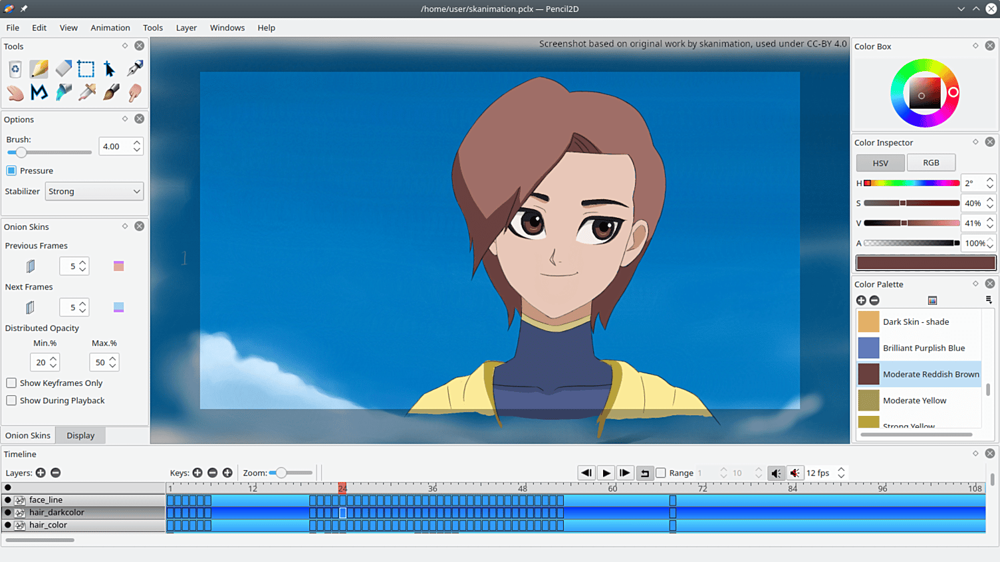
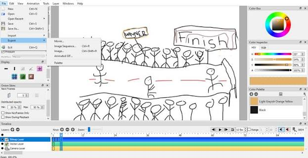

# Pencil2D: Hand-Drawn Motion on a Simple Timeline

A short animated gesture begins with a few readable poses and the time between them. Pencil2D keeps drawing, layers, and playback together so you can develop that gesture through a pencil 2d workflow before committing to detailed cleanup.

## Give Each Layer a Clear Job

Choose the layer for the material you are editing. Drawing layers hold artwork, while camera and sound layers serve different purposes within the shot.

| Layer | Material or control | Practical role in a short scene |
| --- | --- | --- |
| Bitmap | Pixel-based artwork | Rough drawings, painted shapes, and frame-by-frame cleanup |
| Vector | Editable vector artwork | Testing line and shape work with the available vector tools |
| Camera | Camera field and framing | Defining the visible composition |
| Sound | Audio clips | Providing a timing reference for the action |

Name layers by purpose so a rough drawing is easy to distinguish from final artwork. Check the selected layer before adding a drawing or changing the framing.

The vector toolset has limitations, so test the operations your shot needs before relying on it for finished production. Bitmap layers provide a direct route for traditional drawn frames.

[](https://pencil-2d.github.io/Pencil2d-Animation/)

## Set the Rhythm Before Adding Drawings

For pencil2d animation, the spacing of poses and their exposure on the timeline both affect perceived movement. Establish the important poses, then decide how long each remains visible.

At 24 frames per second, a four-second shot spans 96 timeline frames. Holding each drawing for two frames would require 48 drawing exposures if that pattern continued throughout the shot.

This standalone Python calculation helps plan an evenly timed passage; it does not change a Pencil2D project:

```python
fps = 24
duration_seconds = 4
frames_per_drawing = 2
timeline_frames = fps * duration_seconds
drawing_exposures = timeline_frames // frames_per_drawing
print(timeline_frames, drawing_exposures)
```

Use those numbers as planning inputs. A pause, fast action, or accented pose can justify a different exposure length.

### Work Through a Small Action

1. Draw the starting pose, the main change in the action, and the ending pose.
2. Place those drawings at the intended timeline positions.
3. Play the shot to judge rhythm before polishing individual lines.
4. Add breakdowns where the path of motion is unclear.
5. Recheck the action after adding intermediate drawings.



Adding more drawings does not automatically improve the action. Adjust a pose's placement or duration when the problem is timing.

## Use Neighboring Frames as Drawing Guides

Pencil2D onion skinning displays neighboring drawings as references while you work on the current frame. Use it to compare position, spacing, and shape continuity.

Keep the guides visible enough to follow the action without obscuring the current drawing. Watch for accidental changes in volume when a character turns or a shape stretches.

- Compare the silhouette of important poses before refining small details.
- Check that stationary contact points remain consistent.
- Review fast movements at playback speed as well as frame by frame.
- Hide the guides occasionally to judge the current drawing on its own.

The [user manual](https://www.pencil2d.org/doc/user-manual) explains the timeline, keyframes, camera field, and onion-skin controls.

### Move from Rough Lines to Cleanup

Use the pencil, pen, brush, eraser, and selection tools according to the task. Test the stroke size and tool settings on the intended drawing layer before cleaning an entire sequence.

In pencil2d software, a readable rough pass can serve as a reference for cleaner artwork on another drawing layer. Preserve the timing while checking that the cleaned drawings still express the same action.



## Keep the Camera Field in the Review

The camera field defines the composition that matters for the finished shot. Work outside it when useful, then review what remains inside the intended frame.

Choose the output dimensions early enough to notice cropping problems. A larger camera field and a longer, layered scene can increase memory demands.

For pencil 2d animation with sound, check the action against the audio reference and review an exported sample before committing to the full scene.

Save numbered project versions at meaningful milestones, such as rough timing, breakdowns, and completed cleanup. Keep the editable project alongside the rendered result.

The [project-format explanation](https://www.pencil2d.org/doc/faq#understanding-pencil2d-save-files-pcl-legacy--pclx) distinguishes the compressed PCLX container from legacy PCL files and their accompanying data folders.

## Export a Shot You Can Inspect

Pencil2D animation software supports image-sequence and movie export. Choose an image sequence when individual frames are useful for compositing or a separate encoding step.

For the following Bash example, assume an installed executable named `pencil2d`, an existing project named `gesture.pclx`, and a writable output directory. Change the executable name or path for your installation:

```bash
pencil2d gesture.pclx --export gesture-review.mp4 \
  --start 1 --end 96 \
  --width 1280 --height 720
```

The example requests a movie of frames 1 through 96 at the specified dimensions. It uses the export options defined by the upstream [command-line parser](https://github.com/pencil2d/pencil/blob/master/app/src/commandlineparser.cpp).

Check the exported framing, duration, first and last frames, and any audio. A successful export should still receive a visual playback review.

### Encode an Existing Image Sequence Separately

If you have exported opaque, consistently sized PNG frames numbered from `gesture-0001.png` onward, FFmpeg can encode them into a review movie. This command belongs to FFmpeg and requires a build with the libx264 encoder:

```bash
ffmpeg -framerate 24 -start_number 1 \
  -i "gesture-%04d.png" \
  -c:v libx264 -pix_fmt yuv420p gesture-encoded.mp4
```

Use even image dimensions for this encoding example. The input frame rate controls playback timing; this MP4 example does not preserve transparency or add sound.

The [FFmpeg image-sequence documentation](https://ffmpeg.org/ffmpeg-formats.html#image2-1) explains frame-number patterns and input frame rates.

## Supporting Files for Implementation Reference

The supplied files are supporting materials from Krita, a separate application. They are included here as implementation references; Pencil2D source code and example animation projects are absent from this collection.

### Build Configuration and Platform Choices

The root [CMakeLists.txt](CMakeLists.txt) declares the Krita project. [config-hdr.h.cmake](config-hdr.h.cmake) and [config-gsl.h.cmake](config-gsl.h.cmake) are templates for optional build capabilities.

[config-hash-table-implementation.h.cmake](config-hash-table-implementation.h.cmake) controls a hash-table build definition, while [config-android-stdio-forwarding.h.cmake](config-android-stdio-forwarding.h.cmake) supplies an Android logging-related definition.

The Windows compatibility approach is explained in [README](winquirks/README) and implemented in the supplied [unistd.h](winquirks/unistd.h).

### Packaging References

- [windows.yml](build-tools/ci-scripts/windows.yml), [linux.yml](build-tools/ci-scripts/linux.yml), and [macos.yml](build-tools/ci-scripts/macos.yml) describe platform CI jobs.
- [build-windows-package.py](build-tools/ci-scripts/build-windows-package.py) prepares Windows packages.
- [build-appimage.py](build-tools/ci-scripts/build-appimage.py) stages Linux AppImage packaging.
- [build-plugins.py](build-tools/ci-scripts/build-plugins.py) coordinates external-plugin builds.
- [CMakeLists.txt](3rdparty_plugins/CMakeLists.txt) configures external plugins, including the G'MIC definition in [CMakeLists.txt](3rdparty_plugins/ext_gmic/CMakeLists.txt).

The Docker environment note in [README.md](build-tools/docker/README.md) points to its relocated repository.

### Python Tooling and Attribution

[dev-requirements.txt](dev-tools/python/dev-requirements.txt) lists Python development dependencies. [setup.py](dev-tools/python/krita-mock/setup.py) packages a test mock, and [__init__.py](dev-tools/python/krita-mock/src/krita/__init__.py) implements that mock with MagicMock.

[AUTHORS](AUTHORS) provides an attribution pointer and maintainer information for the supplied companion materials.

## Related Search Terms

pencil 2d, pencil2d animation, pencil2d software, pencil 2d animation, pencil2d animation software, animation, bitmap, cartoon, drawing, graphics2d, onion-skin, pencil2d, vector-graphics, multi-platform, cplusplus
